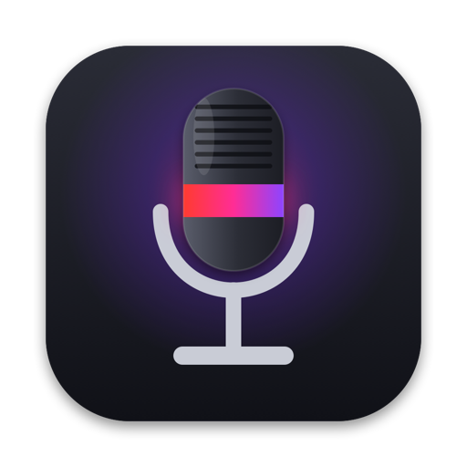
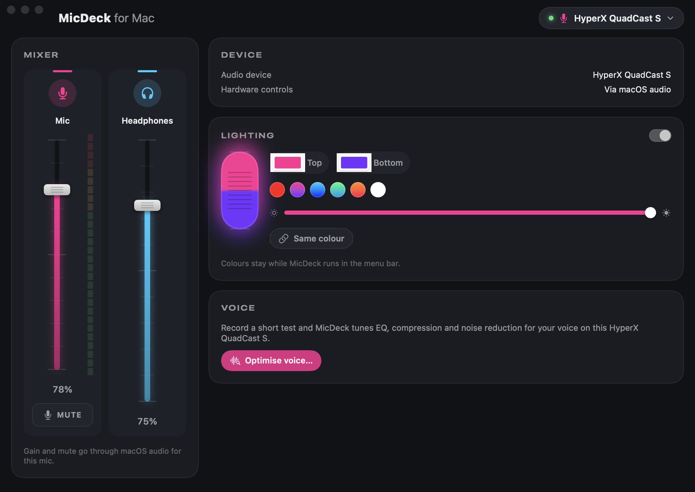
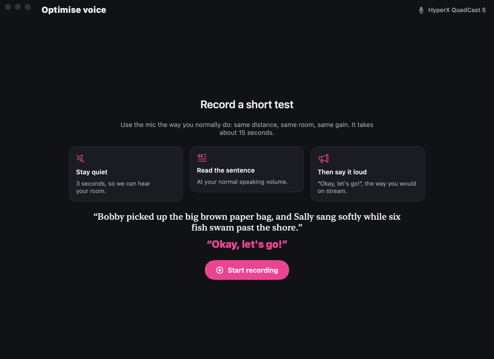

<p align="center"></p>

<h1 align="center">MicDeck for Mac</h1>

<p align="center">
  Controls for HyperX USB microphones on macOS, and a voice optimiser that tunes them to your voice.<br>
  <a href="https://jonathan-fielding.github.io/MicCheck/">Website</a> ·
  <a href="https://github.com/jonathan-fielding/MicCheck/releases/latest">Download</a>
</p>



MicDeck is a menu bar app that gives HyperX mics the controls macOS leaves out. It only shows the controls your mic actually has.

- **Gain and mute**: a fader with a live level meter. On newer mics, mute follows the mic's own knob and tap-to-mute.
- **Headphones and monitoring**: headphone volume, plus the mic/playback monitoring balance on mics that have it.
- **Polar pattern**: cardioid, stereo, omni or bidirectional on the QuadCast 2 S.
- **Low cut**: the mic's built-in high-pass filter.
- **QuadCast S lighting**: separate top and bottom colours and brightness, held for as long as MicDeck runs.
- **Voice optimiser**: record a 15-second test and MicDeck builds a voice chain (high-pass, noise gate, 5-band EQ, de-esser, compressor, limiter) for you, explaining each choice. Apps record the result from the **MicDeck Microphone** input.

## Supported mics

| Mic | Gain & mute | Headphones | Polar pattern | Monitor mix | Low cut | Lighting |
|---|:-:|:-:|:-:|:-:|:-:|:-:|
| QuadCast 2 S | ✓ | ✓ | ✓ | ✓ | | |
| QuadCast S | ✓ | ✓ | | | | ✓ |
| QuadCast | ✓ | ✓ | | | | |
| SoloCast 2 Pro | ✓ | ✓ | | | ✓ | |
| SoloCast 2 | ✓ | | | | ✓ | |
| SoloCast | ✓ | ✓ | | | | |
| FlipCast | ✓ | ✓ | | | ✓ | |

The voice optimiser works with all of them.

## Install

Download both disk images from the [latest release](https://github.com/jonathan-fielding/MicCheck/releases/latest):

1. **MicDeck.dmg**: open it and drag MicDeck to Applications. It starts in the menu bar.
2. **MicDeckAudio.dmg** (only needed for the voice optimiser): run `MicDeckAudio.pkg`. It installs the MicDeck Audio driver into `/Library/Audio/Plug-Ins/HAL`, which is why it asks for your password. To remove it, run `sudo ./uninstall.sh` from the same disk image.

Requires macOS 15 or later, on Apple silicon or Intel.

## Voice optimiser



You stay quiet for 3 seconds so MicDeck can hear the room, read one sentence at your normal volume, then say "Okay, let's go!" the way you would on stream. MicDeck measures pops, sibilance, mud, room noise and peaks, and suggests settings, including changes on the mic itself such as gain, low cut or cardioid. You can A/B the result before applying it.

The processing runs in MicDeck. The MicDeck Audio driver adds two virtual devices that share one clock:

- **MicDeck Microphone**: a normal input you pick in Discord, Zoom, OBS and so on.
- **MicDeck Feed**: a hidden output that MicDeck plays the processed signal into.

MicDeck only opens your real mic while some app is recording from MicDeck Microphone, so the mic and the orange recording indicator are idle the rest of the time.

## Build from source

You need Xcode 16 or later (Swift 6) on macOS 15 or later.

```sh
./build-app.sh                 # dist/MicDeck.app and dist/ngmic (ad-hoc signed, sandboxed)
./build-driver.sh --install    # build and install the MicDeck Audio driver
swift test
```

`build-app.sh --appstore` and `build-driver.sh --release` produce the signed builds. The comments at the top of each script list the signing settings they need.

### Layout

| Path | What's there |
|---|---|
| `Sources/MicKit` | Device discovery, the HID protocol, QuadCast S lighting, Core Audio helpers, and the voice analyser and processor |
| `Sources/MicDeck` | The SwiftUI app |
| `Sources/ngmic` | A command-line tool for the same controls |
| `Driver` | The MicDeck Audio HAL plug-in (C) |
| `docs` | [QuadCast S lighting protocol](docs/quadcast-s-lighting-protocol.md) |
| `site` | The website |

### ngmic

```
ngmic list                       control interfaces and matching audio devices
ngmic monitor                    print every input report (turn knobs, tap mute)
ngmic get                        query mute, polar pattern, mix and low cut
ngmic polar cardioid|omni|stereo|bidirectional
ngmic mute on|off
ngmic mix 0..6                   mic monitoring vs playback (3 = centre)
ngmic lowcut on|off
ngmic led <top> [bottom]         QuadCast S colours (hex, e.g. ff0000), until Ctrl-C
ngmic analyse <file> [out.wav]   run the voice analysis on a recording
```

## Privacy

MicDeck collects no data and makes no network connections. Microphone access drives the level meter and the voice optimiser. The test recording stays in memory while you tune and is never saved or sent anywhere.

## Licence

[MIT](LICENSE) © 2026 Jonathan Fielding

MicDeck is an independent project and isn't affiliated with or endorsed by HP Inc. or HyperX. HyperX, QuadCast, SoloCast and FlipCast are trademarks of their owners.
